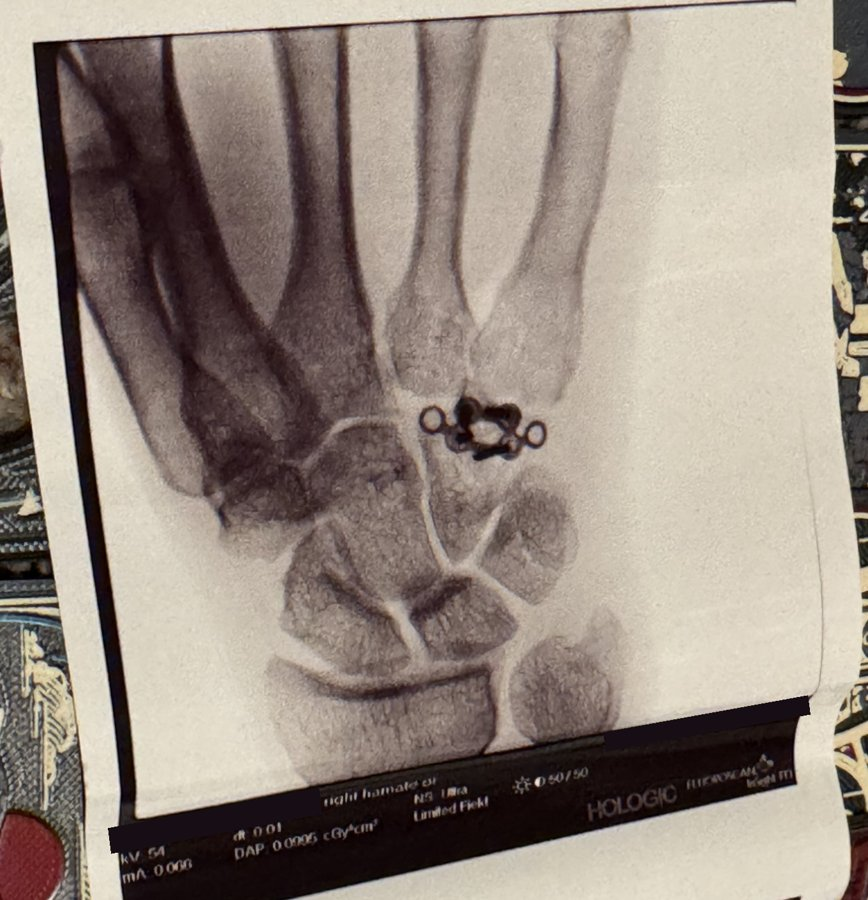

# Zone

I built this because I broke my good hand and god damn it Apple stuff sucks; the keyboard, the dictation, the swipe. So we have all of that made to be wonderful and more

<p align="center"></p>


An iPhone keyboard and app for dictation. Tap the mic, talk, and the text lands at the cursor in any app. Speech recognition runs on the phone: no account, no server, no analytics. Models download when needed; recognition then works offline. Optional sharing and cloud-backed backup destinations are under your control.

Status: free on the [App Store](https://apps.apple.com/app/id6830955448) for iPhone. This repository is the source of Zone 1.0.5, the version on the App Store. [TestFlight invitation](https://testflight.apple.com/join/cStumGN1).

**Two open source parts.** This repository is the iPhone app and keyboard. The computer side, with an MCP server for your AI agents (Claude Code, Codex, Cursor and more), a command line and wireless sync, is [zaydiscold/zone-mcp](https://github.com/zaydiscold/zone-mcp).

Start with the [feature guide](docs/features.md) and the [build changelog](CHANGELOG.md).

## Features

**Keyboard**
- Dictation from the keyboard in any app, with Undo and Redo after each insert
- Full keyboard with autocorrect (77,000 words, tap-position aware), suggestions, clicks and haptics
- Optional English swipe typing, alternatives, whole-word Delete and local learning from explicit choices
- The space bar is a trackpad: slide sideways to move the cursor, up or down to change lines; lift to resume typing
- Compact dictation face: mic, Stop and Pause, live voice graphic, Delete, Return, optional Paste
- Recent dictations one tap away
- Text styles per dictation: casual, very casual, formal, excited
- Spoken formatting: "comma", "period", "new line", "new paragraph", "quote", "bullet point" and more
- Handles: say "at sign Kevin" for @kevin, always. Smart @ (experimental) also takes a bare "at Kevin". Save handles such as cold or txm in Settings > @ Handles; spell "at sign T X M" for @txm. Filtering can make mistakes; review the text before sending.
- Personal words: names and terms spelled your way, including sound-alikes
- California Mode (experimental, off by default): takes the filler "like" out of dictation, lightly or aggressively, and keeps every "like" that means something

**App**
- Voice notes without leaving the current app
- Meeting recorder with a six-hour safety limit, a stop countdown in the last ten minutes, on-device transcription, and optional speaker labels for meetings up to two hours
- Meeting appearance settings with a live preview, timer motion toggle, Gentle/Brisk pace, and Flow/Breathe/Still glow
- Searchable history and saved-audio recovery; recording limits and interruption behavior depend on the recording mode (see below)
- Settings for style, session length, appearance, accent color, sounds, haptics and autocorrect
- Recording log (no text in it) for troubleshooting

**System**
- Shortcuts actions: voice note, dictate and copy, get last dictation
- Controls for the Action Button, Control Center and Lock Screen
- Home Screen and StandBy widget, Live Activity in the Dynamic Island
- Computers (Beta): your library on your own computer and in your AI agents, with [zone](https://github.com/zaydiscold/zone-mcp)

## On your computer: zone

Pair a computer in Settings > Computers (Beta) and every dictation, note and meeting transcript follows to
it a few seconds after you make it, over any network, end to end encrypted, with no account and no Zone
server. The computer side is a separate open source program, **[zone](https://github.com/zaydiscold/zone-mcp)**:
an MCP server for your AI agents (Claude Code, Codex, Cursor, Hermes and more), a command line, and a
local history page. With no network at all, **Flash** sends the library as a stream of color codes from
the phone's screen to the computer's camera.

<p align="center">
  
  &nbsp;
  
</p>

The phone side is in `Zone/Link/` and `ZoneCore/Sources/ZoneCore/Link/`; the wire format is
[zone's PROTOCOL.md](https://github.com/zaydiscold/zone-mcp/blob/main/PROTOCOL.md).

## Speech models

Zone has one speech model, downloaded the first time it's needed. Settings, Speech model explains it and shows each step between speaking and text landing in an app.

| Model | Download | Prepared by iOS | Runtime | License |
| --- | --- | --- | --- | --- |
| [Fluid Speech Mini](https://huggingface.co/FluidVoice-Labs/fluid-speech-mini-coreml) (built on NVIDIA Parakeet TDT 0.6B v3) | 253 MB | about 1.3 GB | Core ML ([FluidAudio](https://github.com/FluidInference/FluidAudio)), CPU | CC BY 4.0 |

It needs iOS 18, Zone's minimum. Moonshine Tiny ("Light", the start for phones before the A17 Pro), Moonshine Small and Medium, and Parakeet 110M are retired: on launch Zone deletes their old downloads, and older reports may still name them. Remove speech model and Remove old models free model files and identifiable compiled caches while preserving recordings. Active recording or processing must finish before deletion.

Downloads can be cancelled and resume where they stopped.

Meeting speaker labels use FluidAudio's diarization models (about 21.6 MB, CC BY 4.0).

## Specs

| | |
| --- | --- |
| iOS | 17.0 or later; widget, Controls and Live Activity need iOS 18 |
| Device | iPhone |
| Storage | 45 to 253 MB for the speech model |
| Network | Recognition offline after model downloads; optional exports/backups may use the chosen destination |
| Permissions | Microphone; the keyboard needs Allow Full Access to reach the app |
| Build | Xcode 26, XcodeGen |

## Speed

| Measurement | Result | Where |
| --- | --- | --- |
| Stop to text, Fluid Speech Mini (then called Heavy), model warm | 0.17 to 0.59 s, including 11 to 15 s clips | iPhone 15 Pro |
| Stop to text, legacy Medium preset, p50 / p90 | 0.44 / 0.90 s | iPhone simulator, LibriSpeech and 30 s dictations |
| Autocorrect per keystroke, mean / p99 | 23 / 175 us | M4 Mac, release build |
| Release 2026110805 core checks | 580 XCTest tests (2 skipped, zero failures) + 19 Swift Testing tests | November 8, 2026 release validation |

These latency figures are historical measurements, not a fresh benchmark of the current two-model lineup or long-meeting performance.

## How it works

- iOS keeps the microphone away from keyboards, so the Zone app records and recognizes speech and the keyboard is the remote control.
- The first dictation opens Zone once to start a session; after that the keyboard mic works on its own until the session ends.
- The app and keyboard share an App Group (preferences, small files, Darwin notifications). This is why the keyboard needs Allow Full Access.
- The keyboard writes text into the field through the standard text input proxy.

## Project layout

| Path | What it is |
| --- | --- |
| `Zone/` | The app: recording, speech engines, notes, meetings, history, settings |
| `ZoneKeyboard/` | The keyboard extension |
| `ZoneActivity/` | Live Activity, widget and Controls |
| `ZoneCore/` | Swift package: text styles, formatting, autocorrect, shared state, tests |
| `Shared/` | Files compiled into more than one target |
| `Config/` | Signing: team, bundle ID prefix, App Group |
| `project.yml` | XcodeGen spec for `Zone.xcodeproj` |

## Build and test

Requires Xcode 26 and XcodeGen. The app targets iOS 17; the widget, Controls and Live Activity need iOS 18.

```bash
brew install xcodegen
xcodegen generate
swift test --package-path ZoneCore
xcodebuild -project Zone.xcodeproj -scheme Zone \
  -destination 'platform=iOS Simulator,name=iPhone 17 Pro' build
```

Run `xcodegen generate` again after adding or removing files.

Simulator builds need ad-hoc signing (`CODE_SIGN_IDENTITY=- CODE_SIGN_STYLE=Manual DEVELOPMENT_TEAM=`). Without it the App Group is dropped and History can't load.

## Install on an iPhone

You need a Mac with Xcode 26 and XcodeGen, the iPhone connected by cable with Developer Mode on (Settings, Privacy & Security), and an Apple ID signed in to Xcode (Settings, Accounts). A free Apple ID works; its installs stop opening after 7 days, so run the script again weekly.

```bash
scripts/install-on-iphone.sh --check   # checks the Mac, the Apple team and the phone; builds nothing
scripts/install-on-iphone.sh           # builds under your Apple ID and installs
```

The project signs as Zayd by default. The script finds your team and writes `Config/Local.xcconfig` (git ignores it), with a bundle ID prefix made from your team ID; edit it to choose your own. Bundle IDs and the App Group follow from that prefix. The keyboard reaches the app only through that App Group, so editing `Zone.xcodeproj` by hand or changing only the team leaves a keyboard that opens Zone to "That didn't work". The script refuses to install a build whose app and keyboard groups differ.

To do it by hand: copy `Config/Local.xcconfig.example` to `Config/Local.xcconfig` and set `DEVELOPMENT_TEAM` (the `OU=` field of `security find-certificate -c "Apple Development" -p | openssl x509 -noout -subject`; the code in parentheses in Xcode's certificate name is the certificate's, not the team's) and `ZONE_BUNDLE_PREFIX`. Then:

```bash
xcodegen generate
xcrun devicectl list devices   # the phone's identifier
xcodebuild -project Zone.xcodeproj -scheme Zone -configuration Release \
  -destination 'platform=iOS,id=<device-udid>' -allowProvisioningUpdates build
xcrun devicectl device install app --device <device-id> <path>/Zone.app
```

Then on the phone:

1. With a free Apple ID, the first time: Settings, General, VPN & Device Management, your Apple ID, Trust.
2. Go to Settings, General, Keyboard, Keyboards, Add New Keyboard, and choose Zone.
3. Turn on Allow Full Access.
4. Open Zone once and allow the microphone.

If the keyboard comes up blank after a reinstall, switch keyboards with the globe key and back, or restart the phone.

If the keyboard says "Zone's keyboard can't reach the app yet" with Full Access on, close the app you are typing in and open it again. If it keeps saying so, the app and the keyboard were signed with different App Groups: run `scripts/install-on-iphone.sh` again.

## License

MIT, see `LICENSE`. Third-party code, models, word lists and sounds are listed in `THIRD-PARTY-NOTICES.md`.

### This source and the App Store build

This is the source of the app on the App Store. The store build also carries a short list of
coarse words, which it never suggests and never corrects to. That list is left out here, so a
build of this source treats those words as unknown.

### Keep your notes

Settings → Your data → Backup and export saves a complete `.zonebackup` document through Files, including notes, dictation history, meeting transcripts, speaker names and meeting audio. The document also contains a readable text export. Choose On My iPhone or iCloud Drive, outside Zone's own folder if you intend to delete the app. Import adds missing records and keeps existing ones; repeated imports do not duplicate them. Imported dictation history is kept until you delete it.

You can also choose a folder for automatic backups. Zone updates that copy while the app is running, and retains records previously backed up even when you delete them in the app. Stop a meeting to include its finished audio. The last-save time confirms a file write; iCloud Drive delivery is handled by iOS. Save a backup before a clean reinstall.

### Meeting recording limits and appearance

Start from **Meeting** on Home. The recorder shows elapsed time, with Pause/Resume and Stop. Meeting Home says how long a recording can run, or less when free storage is shorter. In the last ten minutes the recorder and the Lock Screen say when the recording will save and stop; past two hours the recorder notes that the transcript will not have speaker labels. If Zone stops a meeting itself (the six-hour ceiling, low storage, an audio write failure), the Lock Screen keeps saying why instead of the activity disappearing. Stopping saves the audio before queued transcription. The six-hour ceiling counts captured audio, not time spent paused. Low storage or capture trouble can stop a meeting earlier; the saved meeting retains the explanation.

| Setting or mode | What it limits |
| --- | --- |
| New meeting recording | Six hours of captured audio; earlier safety stops are possible |
| Meeting speaker labels | Up to two hours of audio per pass; this is a conservative processing guard |
| Older, longer saved meeting audio | Can be queued for chunked transcription without speaker labels; no verified 10–15-hour end-to-end guarantee |
| Keyboard-origin dictation | Two-hour safety ceiling; can also stop when keyboard/app presence is lost |
| Other app-origin dictation | The keyboard-only ceiling is not applied here; do not interpret that as a tested unlimited recording guarantee |
| Settings → Microphone and timing → Keep microphone ready | How long the microphone stays ready after your last dictation (30 seconds, 1, 5 or 15 minutes, 1 or 6 hours, or until you turn it off). It never ends a recording or a meeting; a dictation left paused saves after the same time, and never sooner than 5 minutes |

Choose **Settings → Meeting appearance** (also linked from Meeting Home):

- **Animate numbers** turns the minimal rolling clock on or off. **Gentle** is the default; **Brisk** shortens the transition.
- **Flow** carries sound around the edge; **Breathe** expands the whole edge with sound; **Still glow** changes brightness without moving the border.
- The live preview uses simulated sound, records nothing, and includes **Pause preview** and **Hour rollover**. The hour enters smoothly at `59:59 → 1:00:00`. Choices persist after relaunch.
- Reduce Motion overrides movement. The live recording screen keeps the timer and recording controls, without a style picker.

Repeated transcription requests are deduplicated and processed serially; lifecycle guards protect pending Start/Stop/Discard operations and model reuse. Synthetic 10-hour and 15-hour PCM-file checks exercised chunking and cancellation, not real speech recognition, speaker accuracy, battery life, or a 15-hour iPhone soak.

### Move the cursor by holding space

On Zone's keyboard, **slide along the space bar** (or hold it, then slide) and it becomes a small trackpad. Lift your finger to return to typing. A slide or a hold never inserts a space; an ordinary tap still does.

- **Sideways** moves by characters. A slow slide moves one character at a time; a fast one covers more text per point, as on Apple's keyboard.
- **Up or down** moves by lines and keeps the cursor's column, pausing at each line break with a tap you can feel. Keep sliding up and down without lifting and the cursor follows, line by line, both ways.
- **Diagonally** does both at once. A sideways scrub that drifts along your thumb's arc never changes lines.

It works with swipe typing on or off, keeps emoji and accented letters whole, and stays in step with apps that report their text late, such as web pages and web-based editors. It is cursor movement, not text selection.

### When meeting voices appear as one speaker

Open the recording, choose **More → Transcribe again**, and select how many people spoke
under **Speakers**. Automatic is the default. The count is a hint for this recording;
short, similar-sounding or overlapping voices can still be mislabeled. Retrying replaces
text edits and speaker names but keeps the original audio. Speaker labels must be enabled
and the speaker model downloaded; labeling is currently limited to recordings up to two
hours. Longer saved audio can still be transcribed without labels.

Audible passages missed by speaker detection are offered to transcription without a
speaker label. A missing label therefore does not by itself mean the words are discarded.
The count option follows the [model creator's documented speaker-count control](https://huggingface.co/pyannote/speaker-diarization-community-1#controlling-the-number-of-speakers).
It does not force every meeting to contain two people.

by zayd/cold @ zayd.wtf

### Swipe typing beta

Enable **Settings → Keyboard → Swipe typing (Beta)**, then glide over letters and lift.
The next word gets a separating space; punctuation attaches to the last word. Tap an
alternative to replace the last swipe, or Delete to remove it as a word. Manual Shift
and the Auto-Capitalization setting still apply. Glide input is disabled for sensitive
fields and VoiceOver; ordinary tap typing remains available.

Recognition runs on-device. Learning remembers only bounded explicit word choices and
previous-word counts, not complete messages or gesture traces. Disable learning or reset
it in the same settings section; reset takes effect the next time the keyboard opens and
keeps your explicit My Words entries. Full Access lets the keyboard read the app's settings.

Powered by FUTO Swipe. Recognition uses the FUTO Swipe Model. Model terms and the MIT VietTelex inference attribution are in
[Swipe notices](ZoneCore/Sources/ZoneCore/Resources/SwipeNotices.txt) and in the app's settings.
The weights are distributed under the FUTO Model Weights License 1.0, separately from
Zone's MIT source code.

The frozen decoder scored 90.91% top-1 and 96.40% top-3 on 46,362 eligible traces from the
49,970-row public FUTO test split. Dictionary/suggestibility and gesture criteria excluded
3,608 rows. This measures corpus recognition, not iPhone typing quality or superiority to
another keyboard. The bundled encoder was trained upstream; Zone did not train a new model.

Reproduce with `scripts/swipe-eval/build-fixtures.py`, then set `ZONE_SWIPE_NEURAL=1`,
`ZONE_SWIPE_FIXTURES` to the generated fixture and
`ZONE_SWIPE_TUNING='{"visitRadius":0,"shortlist":160}'` when running
`swift test -c release --package-path ZoneCore --filter SwipeEvalTests`.
Use the `KeyboardUI` scheme for production model and touch-path regressions in a simulator.
